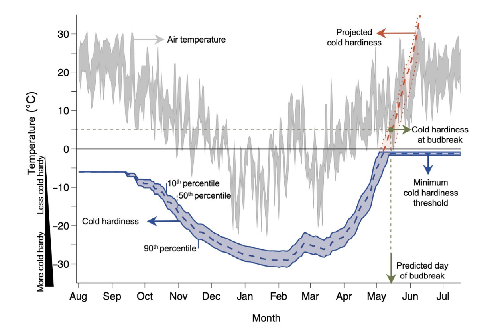
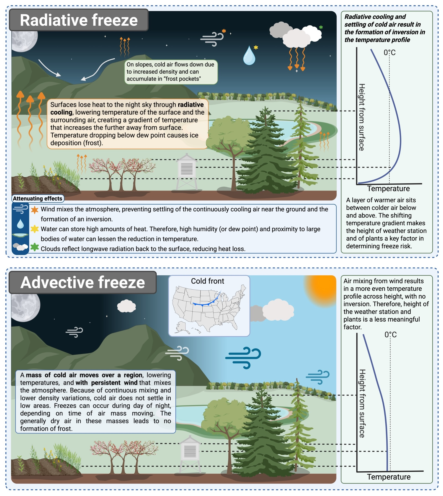
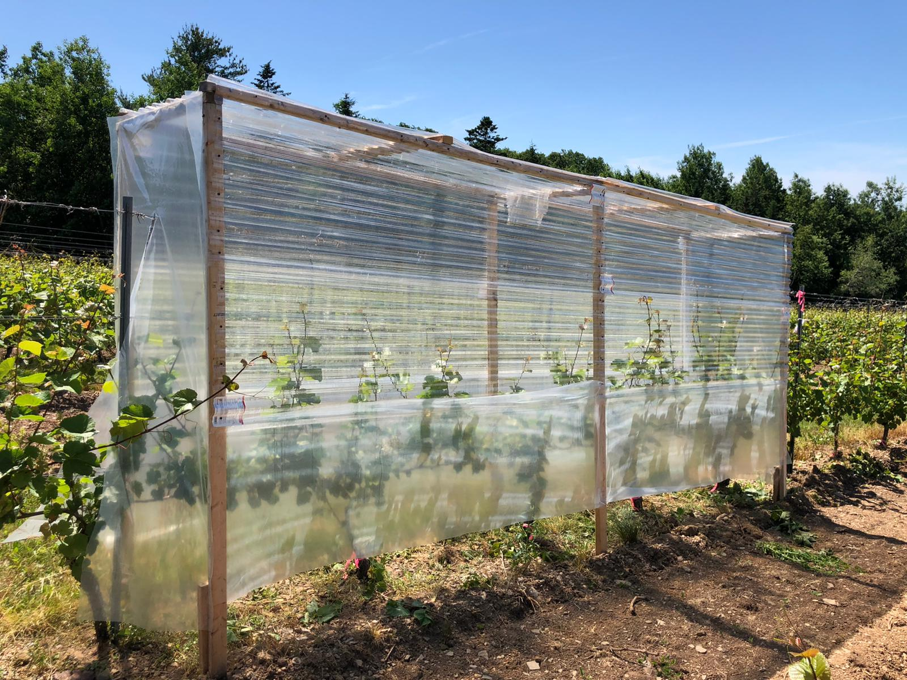

My research focuses on how woody plants respond to temperature, with a 
particular interest in cold hardiness, dormancy, and the consequences of 
climate warming for freeze risk. I combine controlled-environment experiments, 
field-based observations, and physiological modeling to understand how plants 
prepare for, survive, and recover from cold temperatures.

  

    <a href="/research/boreal/">
      
      
Warming & Cold Hardiness in Boreal Ecosystems

    </a>
  

  

    <a href="/research/grapevine/">
      
      
Grapevine Cold Hardiness & Budbreak

    </a>
  

  

    <a href="/research/thresholds/">
      
      
Thresholds for Spring Freeze

    </a>
  

  

    <a href="/research/viticulture/">
      
      
Viticulture & Berry Physiology

    </a>
  

