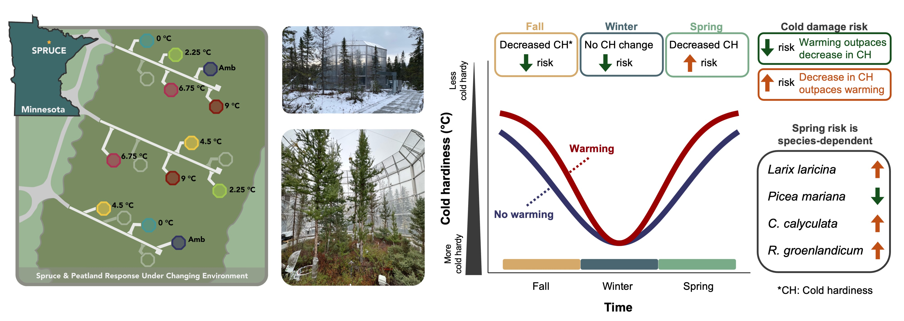

My Ph.D. dissertation was conducted in collaboration with the SPRUCE experiment (Spruce and Peatland Responses Under Changing Environments), a large-scale whole-ecosystem warming and elevated CO₂ project located in a boreal peatland in northern Minnesota. Working with overstory and understory woody species, I investigated how warming affects cold hardiness dynamics, dormancy progression, and the risk of freeze damage in a warmer world.

One of the interesting findings of this work is that warming does not simply reduce freeze risk. Depending on the species and the season, a warmer climate can actually increase vulnerability to cold damage by shifting the timing of dormancy and hardiness in ways that leave plants more exposed to late freezes. This work has broad implications for forest management and conservation in a changing climate.

*Whole ecosystem warming did not alter maximum midwinter cold hardiness of four boreal peatland species, but delayed fall acclimation and especially accelerated spring deacclimation. However, warming only increased cold damage risk in late winter and spring and for three of the four species, suggesting potential shifts in boreal forest composition.*

**Publication**

**Campos-Arguedas, F.**, Kirchhof, E., North, M.G., Pearson, K.J., Guilliams, M.P., Hanson, P.J., Kovaleski, A.P. (2026). Warming reduces cold hardiness of boreal plants but damage risk varies by species and season. *Global Change Biology.* [https://doi.org/10.1111/gcb.71081](https://doi.org/10.1111/gcb.71081)

**Dataset**

Campos-Arguedas, F., Kirchhof, E., North, M.G., Pearson, K.J., Guilliams, M.P., Hanson, P.J., Kovaleski, A.P. (2026). SPRUCE bud cold hardiness of trees and shrubs in experimental plots, Marcell Experimental Forest, Minnesota, 2021–2025. ESS-DIVE. [https://doi.org/10.15485/3408148](https://doi.org/10.15485/3408148)
