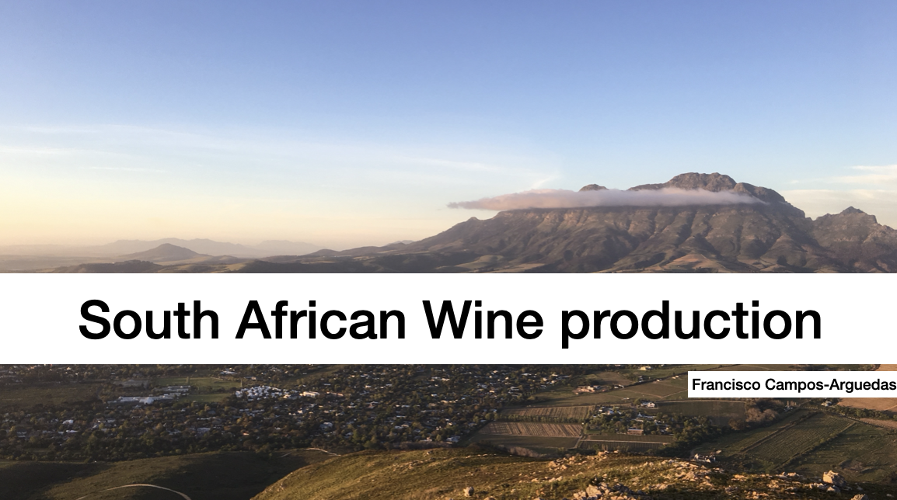

Teaching and mentorship are central to who I am as a scientist. I believe that 
learning happens best in inclusive, supportive environments where students feel 
seen and challenged at the same time. My approach draws on active learning, 
reflection, and open dialogue — whether I am leading a seminar, guiding a lab 
session, or sitting down with a student navigating a difficult moment in their 
academic journey.

---

## Instructor of Record

<strong>CounPsy 115: Academic Excellence Seminar</strong> 
Division for Teaching and Learning, University of Wisconsin–Madison 
<em>Fall 2024, Spring 2025, Fall 2025, Spring 2026</em>  
Designed and delivered a seminar supporting student persistence and academic 
skill development among Posse Scholars. Planned and facilitated weekly classes 
and active-learning activities, developed group projects and individual 
assessments, and managed course materials through Canvas.

---

## Guest Lecturer

<strong>Hort 330: Wines and Vines of the World</strong> 
Department of Plant and Agroecosystem Sciences, University of Wisconsin–Madison 
<em>Spring 2025</em>  
Delivered a guest lecture on South African wine production, integrating 
viticultural, oenological, and regional perspectives.

---

## Teaching Assistant

<strong>Hort 330: Wines and Vines of the World</strong> 
Department of Plant and Agroecosystem Sciences, University of Wisconsin–Madison 
<em>Spring 2023</em>  
Prepared quizzes and assessments, supported communication between students and 
the course instructor, and coordinated logistics for weekly wine tasting sessions.

---

## Study Abroad

<strong>UW Tropical Horticulture — Study Abroad in Costa Rica</strong> 
Department of Plant and Agroecosystem Sciences, University of Wisconsin–Madison 
<em>Winter 2023 & 2024</em>  
Assisted with daily program coordination and field-based activities. Co-led 
evening reflection sessions incorporating active-learning and problem-based 
approaches, and facilitated communication among students, program leaders, and 
community partners.

---

## Mentorship

<strong>Posse Program Mentor</strong> 
The Posse Foundation, University of Wisconsin–Madison 
<em>Fall 2024–Spring 2026</em>  
Provided individual and group mentorship to Posse Scholars, supporting them 
through academic and personal challenges. Connected students with campus resources 
and collaborated with Posse staff and university liaisons to promote an inclusive 
and supportive learning environment.

---

## Recognition

<strong>CALS Graduate Mentoring Award</strong> (2026)
 
College of Agricultural and Life Sciences, University of Wisconsin–Madison
